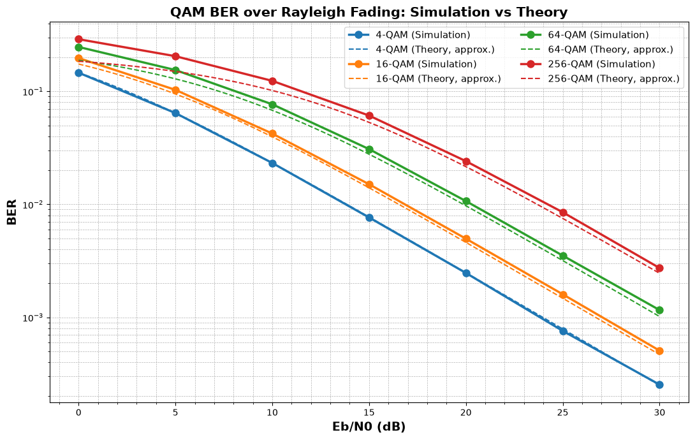
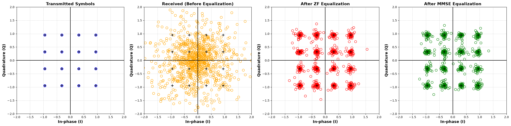
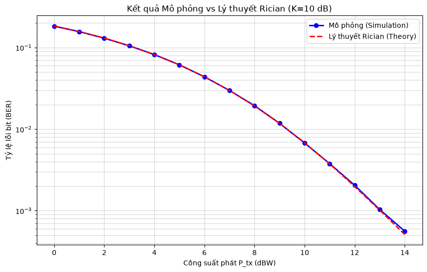
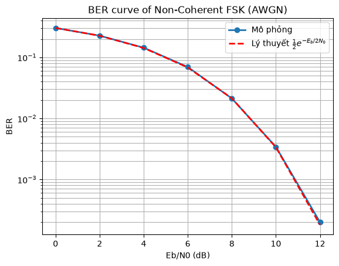
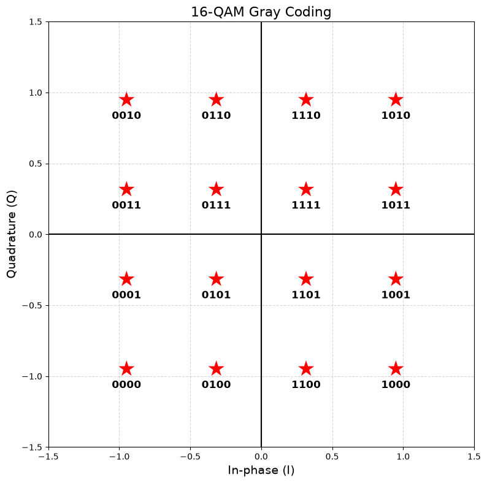

# Wireless Channel Simulator

Mô phỏng Monte Carlo tỷ lệ lỗi bit (BER) của các kiểu điều chế số khi truyền qua kênh **AWGN**, **Rayleigh** và **Rician**, rồi so sánh với công thức lý thuyết. Code viết bằng Python, chỉ dùng NumPy, SciPy và Matplotlib.



## Nội dung

| Điều chế | Kênh | Cân bằng | So sánh lý thuyết |
|---|---|---|---|
| BFSK (giải điều chế không kết hợp) | AWGN | Không cần | $\frac{1}{2}e^{-E_b/2N_0}$ |
| M-QAM (4, 16, 64, 256), mã Gray | Rayleigh | ZF / MMSE | Xấp xỉ láng giềng gần nhất |
| QPSK | Rician (K = 10 dB), tuyến vệ tinh GEO | ZF | Tích phân chính xác theo pdf Rician |

## Cấu trúc thư mục

```
.
├── Wireless_channel/
│   ├── channel.py      # Thư viện: kênh, điều chế, cân bằng, BER lý thuyết
│   ├── Modulation.py   # Script QPSK qua tuyến vệ tinh GEO 12 GHz (link budget + Rician)
│   ├── main.ipynb      # FSK, M-QAM qua Rayleigh, chòm sao trước/sau cân bằng, QPSK Rician
│   └── rician.ipynb    # QPSK qua Rician: mô phỏng vs lý thuyết, từng bước
├── theory/
│   ├── AWGN.md         # Ghi chú lý thuyết kênh AWGN
│   └── Rayleigh.md     # Ghi chú lý thuyết kênh Rayleigh, ZF/MMSE
├── images/             # Hình kết quả dùng trong README
└── requirements.txt
```

## Cài đặt

Yêu cầu Python 3.10 trở lên.

```bash
git clone https://github.com/TriLe1016/Wireless_channel-.git
cd Wireless_channel-
python3 -m venv .venv
source .venv/bin/activate        # Windows: .venv\Scripts\activate
pip install -r requirements.txt
```

## Cách chạy

**Notebook:** mở `Wireless_channel/main.ipynb` hoặc `Wireless_channel/rician.ipynb` trong VS Code hoặc Jupyter, chọn kernel `.venv`, rồi bấm **Run All**. Notebook phải được chạy từ trong thư mục `Wireless_channel/` để import được `channel.py`. VS Code và Jupyter mặc định đã làm như vậy.

**Script tuyến vệ tinh:**

```bash
cd Wireless_channel
python Modulation.py
```

**Dùng thư viện trong code riêng:**

```python
import numpy as np
from channel import QAM, Rayleigh_fading, compute_ber, ber_mqam_rayleigh

qam = QAM(16)
bits = np.random.randint(0, 2, 400_000)
EbN0_dB = 15
snr_db = EbN0_dB + 10 * np.log10(qam.k)          # Eb/N0 -> Es/N0

y = Rayleigh_fading(qam.bits_to_symbols(bits), snr_db, equalizer='zf')
print(compute_ber(bits, qam.symbols_to_bits(y)), ber_mqam_rayleigh(EbN0_dB, 16))
```

## Mô hình và quy ước

- Mô hình tín hiệu băng gốc phức: $y = h\,x + n$, với $n \sim \mathcal{CN}(0, N_0)$.
- Công suất symbol được chuẩn hóa $E_s = 1$. Tham số `snr_db` trong `channel.py` là $E_s/N_0$:

$$\frac{E_s}{N_0}\Big|_{dB} = \frac{E_b}{N_0}\Big|_{dB} + 10\log_{10}k, \qquad k = \log_2 M$$

- Mọi kênh đều được chuẩn hóa $E[|h|^2] = 1$:
  - Rayleigh: $h \sim \mathcal{CN}(0, 1)$.
  - Rician: $h = \sqrt{\tfrac{K}{K+1}} + \mathcal{CN}\!\left(0, \tfrac{1}{K+1}\right)$.
- Fading nhanh: mỗi symbol có một hệ số $h$ độc lập. Máy thu được giả sử biết chính xác $h$ (perfect CSI).
- Cân bằng kênh:
  - **ZF** $\hat{x} = y/h$ là cách mặc định. Với kênh 1 tap, đây là bộ tách tối ưu ML.
  - **MMSE** $\hat{x} = \frac{h^*}{|h|^2+N_0}y$ làm chòm sao co về gốc, nên cho kết quả kém hơn với QAM bậc cao (xem hình dưới).

## Kết quả

### Chòm sao 16-QAM trước và sau cân bằng (Rayleigh, Eb/N0 = 20 dB)



### QPSK qua kênh Rician, K = 10 dB



### BFSK không kết hợp qua kênh AWGN



### 16-QAM với mã Gray



## Tuyến vệ tinh GEO (`Modulation.py`)

| Thông số | Giá trị |
|---|---|
| Tần số sóng mang | 12 GHz |
| Khoảng cách | 36 000 km, suy hao không gian tự do FSPL ≈ 205,15 dB |
| Độ lợi anten phát / thu | 30 dBi / 30 dBi |
| Nhiệt độ tạp âm hệ thống | 500 K |
| Băng thông | 1 MHz |
| Hệ số Rician K | 10 dB |
| Công suất phát $P_{tx}$ | 0 → 30 dBW |

SNR tại máy thu được tính như sau:

$$\text{SNR} = P_{tx} + G_{tx} + G_{rx} - \text{FSPL} - 10\log_{10}(k_B T_{sys} B)$$

Script giả sử tốc độ symbol bằng băng thông, nên SNR này chính là $E_s/N_0$.

Lưu ý: script mô phỏng 200 000 bit, nên đường mô phỏng chỉ tin cậy đến BER khoảng $10^{-4}$. Muốn vẽ thấp hơn thì tăng `num_bits`.
